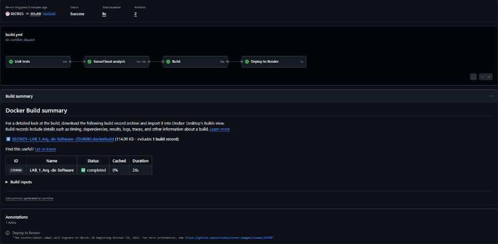
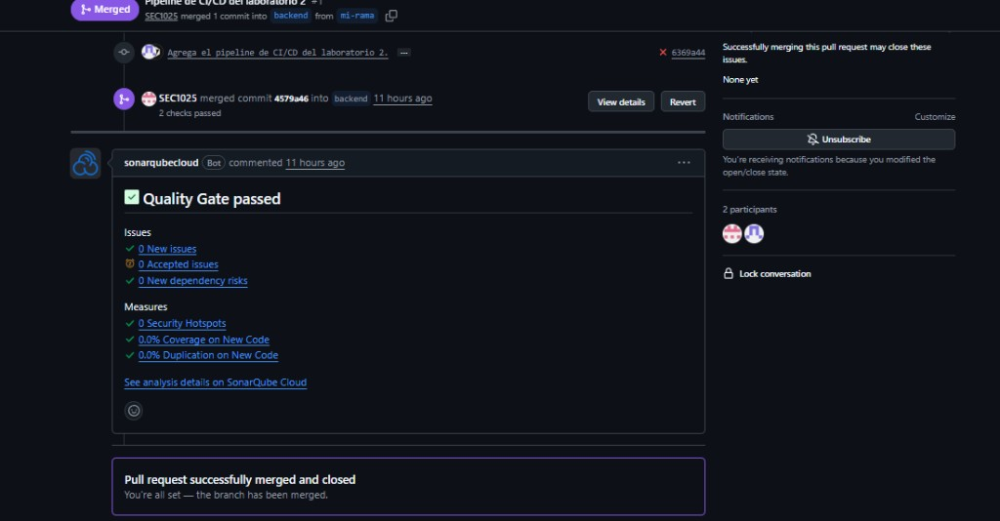
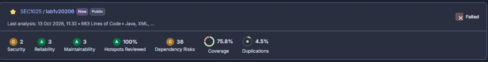
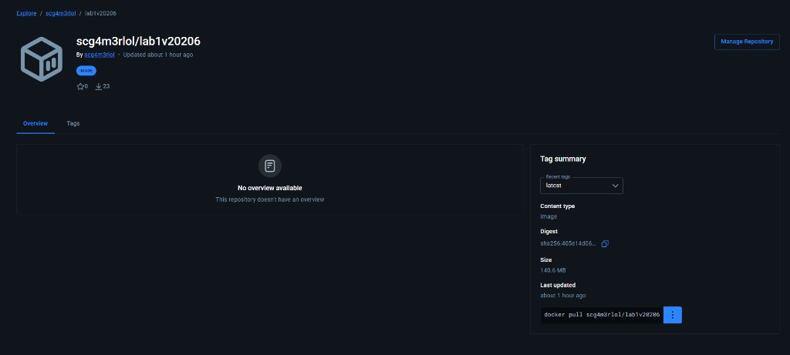
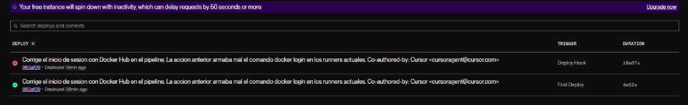
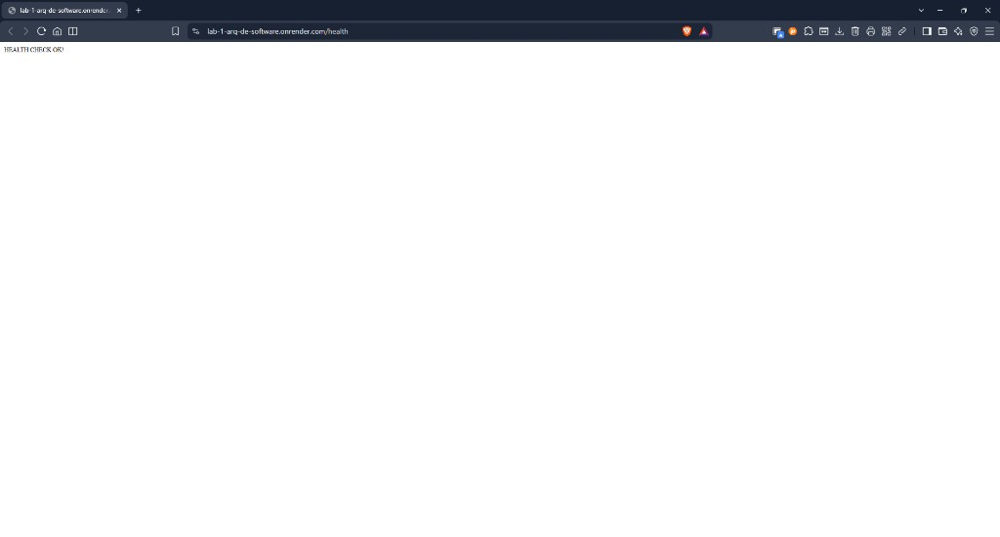
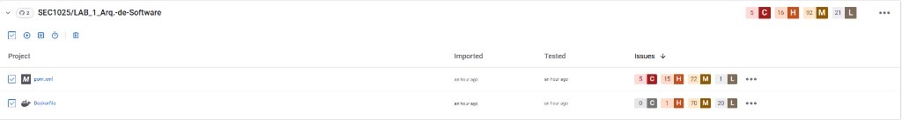

[](https://github.com/SEC1025/LAB_1_Arq.-de-Software/actions/workflows/build.yml)

[](https://sonarcloud.io/summary/new_code?id=SEC1025_LAB_1_Arq.-de-Software)

[](https://sonarcloud.io/summary/new_code?id=SEC1025_LAB_1_Arq.-de-Software)

[](https://snyk.io/test/github/SEC1025/LAB_1_Arq.-de-Software)

Backend del Laboratorio 1 (banco) con el pipeline del Laboratorio 2.

* Consultar y crear clientes
* Transferir entre cuentas y ver el historial
* Health check
* Versión de la aplicación

Incluye GitHub Actions, SonarCloud, JaCoCo, Docker Hub, Render y Snyk.

### Estructura

En `src/main` está el código de la aplicación.
En `src/test` están las pruebas.
En `.github/workflows/build.yml` está el pipeline. Se ejecuta en `main`, `backend` y `mi-rama`.

### Cómo ejecutarla

Con MySQL local (`banco2025`, usuario `root`):

```shell
./mvnw spring-boot:run
```

En Windows:

```shell
mvnw.cmd spring-boot:run
```

Sin MySQL, con base en memoria:

```shell
mvnw.cmd spring-boot:run -Dspring-boot.run.profiles=h2
```

### Cómo probarla

```shell
mvnw.cmd clean test
```

Cobertura JaCoCo (HTML en `target/site/jacoco/index.html`):

```shell
mvnw.cmd -B test
```

### Endpoints

| Método | Ruta | Uso |
|---|---|---|
| GET | `/health` | Estado de la app |
| GET | `/version` | Versión |
| GET | `/api/customers` | Listar clientes |
| GET | `/api/customers/{id}` | Cliente por id |
| POST | `/api/customers` | Crear cliente |
| POST | `/api/transactions` | Transferencia |
| GET | `/api/transactions/{accountNumber}` | Historial |

### Despliegue

La imagen Docker está en [scg4m3rlol/lab1v20206](https://hub.docker.com/r/scg4m3rlol/lab1v20206).
La aplicación en la nube responde en [https://lab-1-arq-de-software.onrender.com/health](https://lab-1-arq-de-software.onrender.com/health).
Render usa el perfil `h2`, así que arranca con una base en memoria.

### Evidencia

Pipeline en verde: pruebas, SonarCloud, construcción de la imagen y despliegue en Render.



Pull request de `mi-rama` fusionado en `backend`.



Análisis de SonarCloud.



Imagen publicada en Docker Hub.



Despliegues del servicio en Render.



Respuesta del backend en la nube.



Análisis de Snyk sobre el repositorio. Más detalle en [snyk.io/test/github/SEC1025/LAB_1_Arq.-de-Software](https://snyk.io/test/github/SEC1025/LAB_1_Arq.-de-Software).


