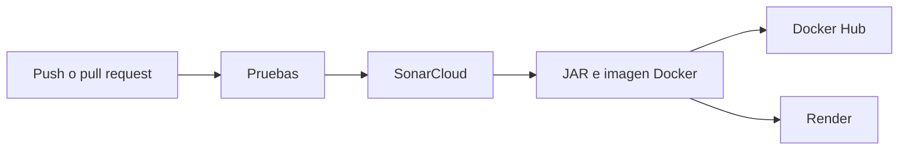

# Banco — Laboratorio de Arquitectura de Software

API REST de un banco pequeño, construida con Spring Boot y publicada con un pipeline de integración y despliegue continuo.

Cada cambio en `backend` o `mi-rama` se prueba, se analiza, se empaqueta en Docker y se publica en la nube.

[](https://github.com/SEC1025/LAB_1_Arq.-de-Software/actions/workflows/build.yml)
[](https://sonarcloud.io/summary/new_code?id=SEC1025_LAB_1_Arq.-de-Software)
[](https://sonarcloud.io/summary/new_code?id=SEC1025_LAB_1_Arq.-de-Software)
[](https://snyk.io/test/github/SEC1025/LAB_1_Arq.-de-Software)

| | |
|---|---|
| Aplicación en vivo | [lab-1-arq-de-software.onrender.com/health](https://lab-1-arq-de-software.onrender.com/health) |
| Imagen Docker | [scg4m3rlol/lab1v20206](https://hub.docker.com/r/scg4m3rlol/lab1v20206) |
| Calidad | [SonarCloud](https://sonarcloud.io/summary/new_code?id=SEC1025_LAB_1_Arq.-de-Software) |
| Seguridad de dependencias | [Snyk](https://snyk.io/test/github/SEC1025/LAB_1_Arq.-de-Software) |

## Qué hace

El servicio administra clientes y transferencias entre cuentas.

- Crear un cliente y consultar el listado o un cliente por id.
- Transferir dinero de una cuenta a otra y guardar el movimiento.
- Consultar el historial de una cuenta.
- Responder el estado de la aplicación y su versión.

## Cómo viaja un cambio



El flujo está en `.github/workflows/build.yml` y se dispara al hacer push a `main`, `backend` o `mi-rama`, al abrir un pull request hacia `main` o `backend`, y también de forma manual.

1. **Pruebas.** JUnit levanta la aplicación con una base H2 en memoria y comprueba clientes, transferencias, `/health` y `/version`.
2. **Calidad.** JaCoCo mide la cobertura y SonarCloud publica el análisis.
3. **Artefacto.** Maven genera `lab1v20206.jar` y Docker construye la imagen `scg4m3rlol/lab1v20206:latest`.
4. **Nube.** Render redespliega el contenedor. En la demo usa el perfil `h2`, así que no necesita MySQL.

La integración de `mi-rama` hacia `backend` se hizo con un pull request, siguiendo una estrategia trunk-based.

## API

La aplicación escucha en el puerto `8080`.

| Método | Ruta | Qué devuelve |
|---|---|---|
| GET | `/health` | `HEALTH CHECK OK!` |
| GET | `/version` | Versión actual de la aplicación |
| GET | `/api/customers` | Lista de clientes |
| GET | `/api/customers/{id}` | Un cliente |
| POST | `/api/customers` | El cliente creado |
| POST | `/api/transactions` | La transferencia realizada |
| GET | `/api/transactions/{accountNumber}` | Historial de esa cuenta |

Crear un cliente:

```http
POST /api/customers
Content-Type: application/json

{
  "firstName": "Ana",
  "lastName": "Perez",
  "accountNumber": "ACC-100",
  "balance": 1500.0
}
```

Transferir:

```http
POST /api/transactions
Content-Type: application/json

{
  "senderAccountNumber": "ACC-100",
  "receiverAccountNumber": "ACC-200",
  "amount": 200.0
}
```

Si falta una cuenta o el saldo no alcanza, la API responde `400` con el motivo.

## Ejecutarla en local

Hace falta Java 17. No hace falta instalar Maven: el proyecto trae el wrapper.

Con MySQL local, base `banco2025` y usuario `root`:

```shell
mvnw.cmd spring-boot:run
```

Sin MySQL, con base en memoria:

```shell
mvnw.cmd spring-boot:run -Dspring-boot.run.profiles=h2
```

Pruebas y reporte de cobertura en `target/site/jacoco/index.html`:

```shell
mvnw.cmd clean test
```

La base local se configura con `DB_URL`, `DB_USER` y `DB_PASSWORD`. Si no se definen, usa `localhost:3306/banco2025`.

## Estructura

```text
src/main/java   Controladores, servicios, entidades y mappers
src/main/resources   Configuración de MySQL, H2 y el perfil de pruebas
src/test        Pruebas de la API
.github/workflows/build.yml   Pipeline de CI/CD
Dockerfile      Imagen de la aplicación
render.yaml     Servicio web en Render
docs/evidencias Capturas de la entrega
```

## Evidencia de la entrega

### Pipeline

Pruebas, análisis, imagen y despliegue terminaron en verde.


### Integración por ramas

El cambio del laboratorio entró por la rama `mi-rama` y se fusionó en `backend`.


### Calidad

SonarCloud midió cobertura, duplicación, seguridad y mantenibilidad.


### Imagen

La imagen `scg4m3rlol/lab1v20206`, etiqueta `latest`, quedó publicada en Docker Hub.


### Nube

Render construyó el servicio desde la rama `backend` y después volvió a desplegarlo con el deploy hook.


El backend responde en [https://lab-1-arq-de-software.onrender.com/health](https://lab-1-arq-de-software.onrender.com/health).


### Dependencias

Snyk revisó `pom.xml` y el `Dockerfile`. El informe completo está en [snyk.io/test/github/SEC1025/LAB_1_Arq.-de-Software](https://snyk.io/test/github/SEC1025/LAB_1_Arq.-de-Software).


